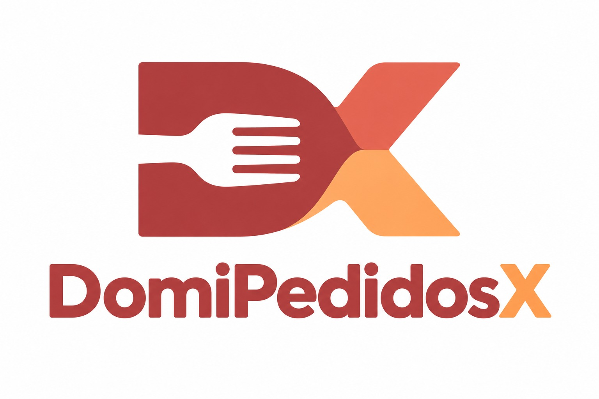

# DomiPedidosX 


Sistema Web de Gestión de Pedidos y Domicilios para Restaurantes. Proyecto académico para la asignatura de Desarrollo de Software I (2026-II) - Universidad del Valle.

## Integrantes del Equipo

* **Miguel Ángel Martinez Eraso:** Product Owner & UX/UI
* **Alejandro Cardona Arellano:** Scrum Master & DevOps
* **Juan Manuel Muñoz Delgado:** Backend & DB Engineer
* **Juan Camilo Ramos Hoyos:** Backend Feature Developer
* **Andres Muñoz Moreno:** Frontend Feature Developer

## Stack Tecnológico

* **Backend:** Python 3.14, Django
* **Base de Datos:** SQLite (Desarrollo) / PostgreSQL (Producción)
* **Frontend:** HTML5, CSS3, JavaScript, Bootstrap

## Instrucciones de Instalación Local

1. **Clonar el repositorio:**
   ```bash
   git clone https://github.com/tu-usuario/domipedidosx.git
   cd domipedidosx
   ```

2. **Crear y activar el entorno virtual:**
   ```bash
   python -m venv venv
   # En Windows:
   venv\Scripts\activate
   # En Mac/Linux:
   source venv/bin/activate
   ```

3. **Instalar dependencias:**
   ```bash
   pip install -r requirements.txt
   ```

4. **Configurar variables de entorno:**
   * Copia el archivo `.env.example` y renómbralo a `.env`.
   * Llena los datos necesarios (ej. `SECRET_KEY`).

5. **Ejecutar migraciones y levantar el servidor:**
   ```bash
   python manage.py migrate
   python manage.py runserver
   ```

## Flujo de Trabajo (Git Flow)

Trabajaremos estrictamente con Pull Requests (PR). Por favor, crea una rama `feature/nombre-de-la-tarea` a partir de `develop` y envía tu PR hacia `develop`.
