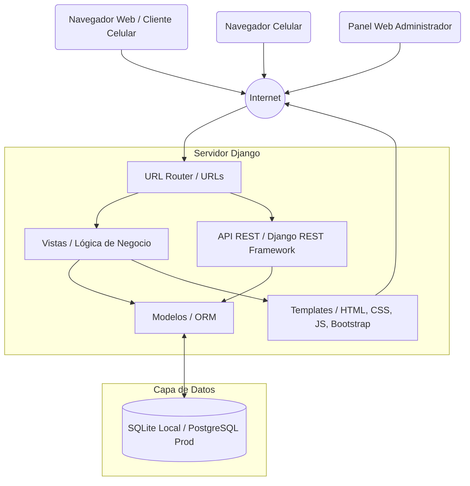

# Arquitectura del Sistema - DomiPedidosX

Este documento describe la arquitectura de software utilizada para el desarrollo del proyecto DomiPedidosX, basada en el patrón arquitectónico **MTV (Model-Template-View)** provisto por el framework Django.

## Diagrama de Arquitectura

## Descripción de Componentes

1. **Cliente Web / Móvil:** Los usuarios (Clientes, Operadores, Cocina, Repartidores) interactúan con el sistema a través de cualquier navegador web responsivo (gracias a Bootstrap).
2. **URL Router:** Recibe las peticiones HTTP y las dirige a la vista o endpoint correspondiente.
3. **Vistas (Views) / API:** Contienen la lógica de negocio. Procesan la información, validan permisos de roles y preparan los datos. Se exponen tanto vistas tradicionales (Render) como endpoints REST.
4. **Templates:** Archivos HTML renderizados del lado del servidor que construyen la interfaz visual.
5. **Modelos (ORM):** Abstracción de la base de datos escrita en Python. Traduce las operaciones de las Vistas a consultas SQL seguras.
6. **Base de Datos:** Motor relacional (SQLite para desarrollo, PostgreSQL para producción) que persiste la información de usuarios, pedidos, menús y configuración.