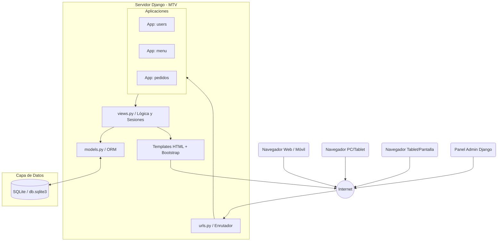

# Arquitectura del Sistema - DomiPedidosX

Este documento describe la arquitectura de software utilizada en DomiPedidosX. El sistema está construido de forma monolítica bajo el framework Django, utilizando el patrón **MTV (Model-Template-View)** con renderizado del lado del servidor (SSR).

## Diagrama de Arquitectura

## Componentes Clave
1. **Aplicaciones Modulares:** El proyecto se divide en `users` (autenticación, roles y direcciones), `menu` (sedes, categorías y productos), y `pedidos` (carrito en sesión transitoria y motor transaccional de órdenes).
2. **Sistema de Sesiones:** El carrito de compras no persiste en base de datos de inmediato; utiliza las sesiones seguras de Django (`request.session`) para almacenar temporalmente los ítems hasta el checkout.
3. **Capa de Presentación:** Utiliza el motor de plantillas de Django renderizando vistas HTML con Bootstrap.
