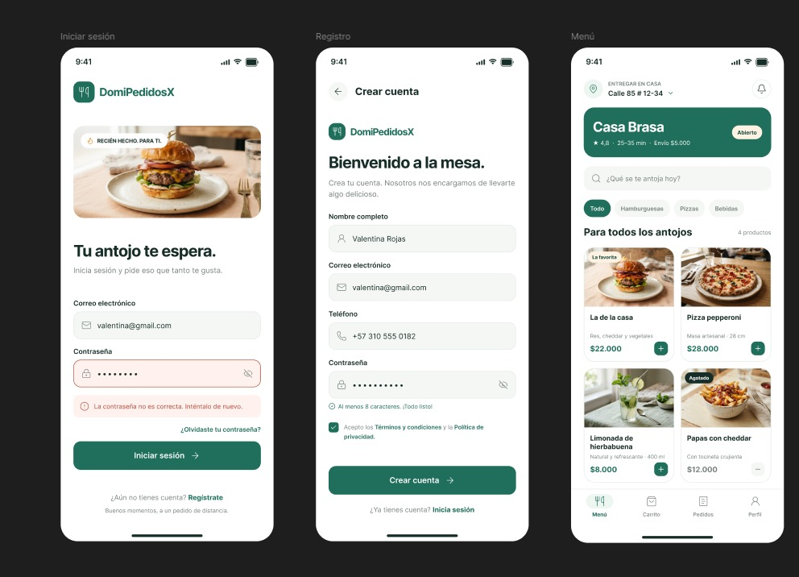
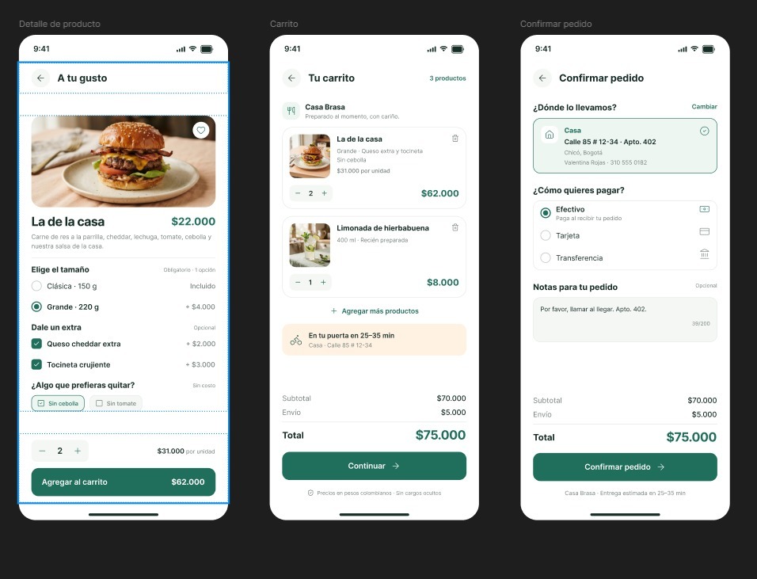
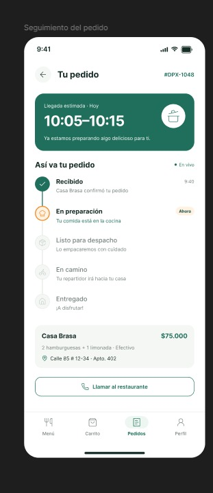
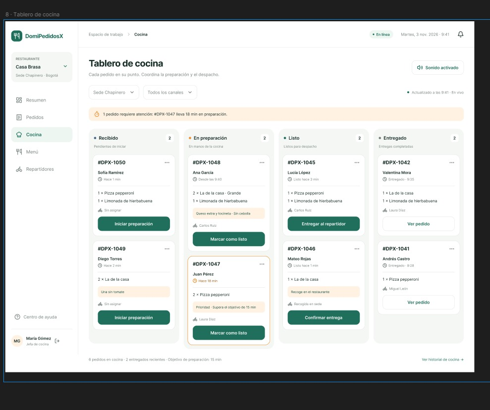
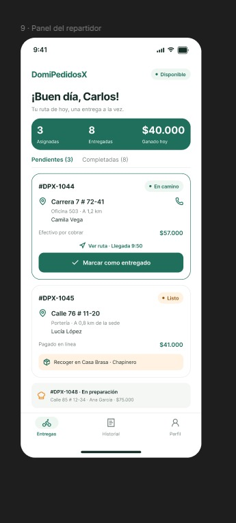
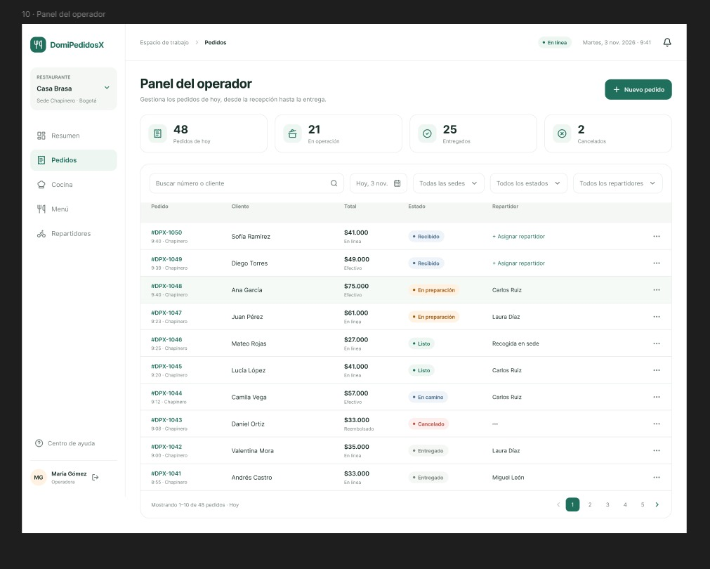
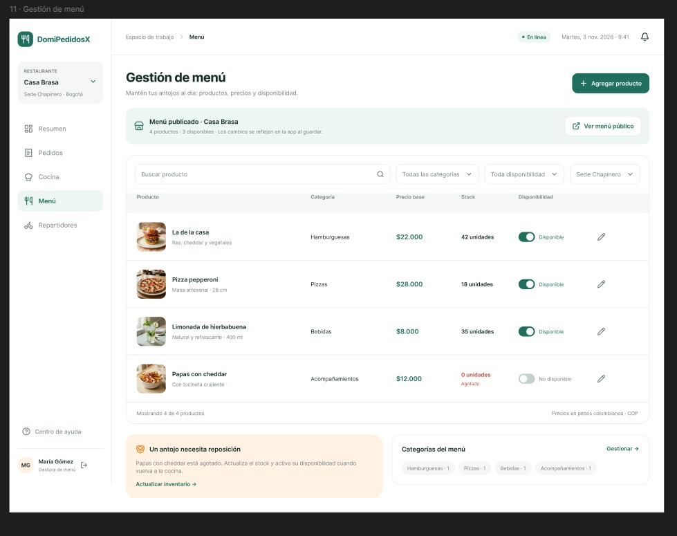
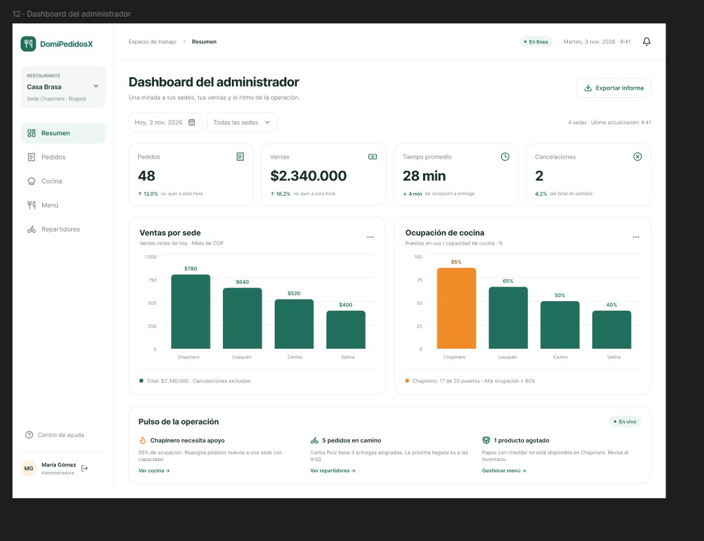

# Entregable Sprint Cero - DomiPedidosX

**Proyecto:** DomiPedidosX (Sistema Web de Gestión de Pedidos y Domicilios)
**Asignatura:** Desarrollo de Software I
**Rol:** Integrante 2 (Scrum Master & DevOps)

Este documento consolida las actividades de configuración e inicialización correspondientes al Sprint Cero del proyecto.

---

## 1. Product Backlog (Historias y Estimaciones)

A continuación se detallan las Historias de Usuario (HU) priorizadas para el inicio del proyecto (Sprint 1), junto con sus respectivas estimaciones (Puntos de Historia) y prioridad MoSCoW.

| ID  | Título / Descripción de la Historia de Usuario | Prioridad | Estimación (Story Points) |
| :--- | :--- | :--- | :--- |
| **HU01** | Como cliente deseo registrarme con mis datos y mi teléfono para poder hacer pedidos. | MUST | 3 |
| **HU02** | Como usuario deseo iniciar sesión para ingresar de forma segura según mi rol. | MUST | 3 |
| **HU03** | Como usuario deseo recuperar mi contraseña para volver a entrar si la olvido. | SHOULD | 3 |
| **HU04** | Como administrador deseo asignar roles a los usuarios para controlar qué puede hacer cada uno. | MUST | 3 |
| **HU05** | Como cliente deseo editar mi perfil y guardar direcciones de entrega para no escribirlas en cada pedido. | MUST | 3 |
| **HU06** | Como administrador deseo desactivar un cliente para que ya no pueda ingresar. | SHOULD | 2 |
| **HU07** | Como administrador deseo registrar y editar sedes con su horario para manejar varias sucursales. | MUST | 3 |
| **HU08** | Como operador de sede deseo crear categorías para organizar el menú. | MUST | 2 |
| **HU09** | Como operador de sede deseo registrar productos con imagen, precio y tiempo de preparación para armar el menú. | MUST | 5 |
| **HU10** | Como operador de sede deseo definir opciones del producto (tamaños, adiciones) para que el cliente lo personalice. | SHOULD | 5 |
| **HU11** | Como operador de sede deseo marcar un producto como disponible o no en mi sede para no vender lo que no hay. | MUST | 2 |
| **HU12** | Como cliente deseo ver el menú con filtros y búsqueda para encontrar rápido lo que quiero. | MUST | 3 |
| **HU39** | Como usuario deseo usar la aplicación desde mi celular para pedir desde cualquier lugar (diseño responsive). | MUST | 3 |

*(Nota: Las estimaciones fueron discutidas y acordadas por el equipo de desarrollo utilizando Planning Poker).*

---

## 2. Prototipos de Interfaz (Figma)

Los siguientes prototipos y wireframes fueron diseñados y entregados por el Integrante 1 (Product Owner & UX/UI), cumpliendo con el Definition of Ready (DoR) para las historias de usuario.

*Figura 1: Pantallas 1, 2 y 3 - Login, Registro de cliente y Menú del cliente.*

*Figura 2: Pantallas 4, 5 y 6 - Detalle de producto, Carrito y Confirmar pedido.*

*Figura 3: Pantalla 7 - Seguimiento del pedido con stepper de estados y tiempo estimado.*

*Figura 4: Pantalla 8 - Tablero de cocina (Kanban) con columnas por estado para los pedidos.*

*Figura 5: Pantalla 9 - Panel del repartidor mostrando la lista de pedidos asignados.*

*Figura 6: Pantalla 10 - Panel del operador con la tabla de pedidos del día, filtros y asignación de repartidores.*

*Figura 7: Pantalla 11 - Gestión de menú mostrando productos, stock y el switch de disponibilidad.*

*Figura 8: Pantalla 12 - Dashboard del administrador con tarjetas de indicadores, ocupación de cocina y resumen de ventas.*

*(Nota: Las imágenes físicas se encuentran alojadas en el directorio `docs/img/` del repositorio).*

---

## 3. Tablero Kanban (Scrum)

Se ha configurado el tablero Kanban utilizando GitHub Projects para hacer el seguimiento del flujo de trabajo del equipo. El tablero incluye las políticas de las siguientes columnas: *Backlog*, *To Do (Sprint Backlog)*, *In Progress*, *Review* y *Done*.

🔗 **Enlace oficial al tablero del proyecto:** 
https://github.com/users/aca2211/projects/1/views/1
